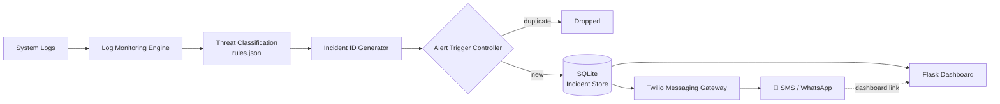

<div align="center">

# 🛡️ Backend Automation Monitoring System

**Spot a suspicious process. Classify it. Get a WhatsApp ping with a dashboard link, all in seconds.**


</div>

---

## 📖 Overview

A Python-based incident response system that watches system logs for suspicious processes, classifies each one against a rule set, and alerts you immediately over SMS or WhatsApp. A Flask dashboard gives you a live view of every incident, and OTP verification makes sure only confirmed users receive alerts.

<!-- Add a screenshot or GIF of your dashboard here -->
<!--  -->

## ✨ Features

| | Feature | What it does |
|---|---|---|
| 🔍 | **Log Monitoring Engine** | Continuously scans system logs for suspicious entries |
| 🧠 | **Threat Classification** | Matches process behavior against rules defined in `rules.json` |
| 🆔 | **Incident ID Generator** | Gives every incident a unique identifier |
| ⏱ | **Timestamping** | Records when each incident occurred, for audit and reporting |
| 🚫 | **Duplicate Alert Filter** | Stops repeated alerts for the same incident |
| 🗄 | **Incident Data Store** | Persists alerts in SQLite for later analysis |
| 📲 | **Real-time Alerts** | Sends SMS/WhatsApp messages via Twilio with a direct dashboard link |
| 🔐 | **OTP Verification** | Confirms a user's number before any alerts go out |
| 🌐 | **Flask Dashboard** | View incidents and severity levels, manage subscriptions, verify OTPs |

## 🧭 How It Works



1. The **Log Monitoring Engine** watches system logs and flags suspicious activity.
2. The **Threat Classification Module** checks each event against `rules.json` and assigns an Incident ID.
3. The **Alert Trigger Controller** filters duplicates, adds a timestamp, and saves the incident to SQLite.
4. A verified user gets an SMS/WhatsApp alert through **Twilio**.
5. The **Flask Dashboard** shows all incidents, severity levels, and subscriptions in one place.

## 🛠 Tech Stack

| Layer | Tools |
|---|---|
| Language | Python |
| Web framework | Flask, Flask-SQLAlchemy |
| Database | SQLite |
| Messaging | Twilio API (SMS / WhatsApp) |
| Config & scripting | JSON rule sets, PowerShell / Bash |

## 🎯 Use Cases

- Endpoint monitoring on small networks
- Security awareness demos
- A hands-on project for learning cybersecurity, automation, and Flask

## 🚀 Getting Started

### Prerequisites

- Python 3.9+
- A [Twilio account](https://www.twilio.com/try-twilio) (the WhatsApp sandbox is enough for testing)

### 1. Clone and set up the environment

```bash
git clone https://github.com/HC1807/Backend-automation-monitoring-system.git
cd Backend-automation-monitoring-system

python -m venv venv
```

Activate it:

```powershell
# Windows (PowerShell)
.\venv\Scripts\Activate.ps1
```

```bash
# macOS / Linux
source venv/bin/activate
```

Then install dependencies:

```bash
pip install -r requirements.txt
```

### 2. Configure Twilio credentials

Keep secrets out of your code. Set them as environment variables:

```powershell
# Windows (PowerShell)
$env:TWILIO_ACCOUNT_SID = "your_account_sid"
$env:TWILIO_AUTH_TOKEN  = "your_auth_token"
$env:FROM_WHATSAPP      = "whatsapp:+14155238886"
$env:TO_WHATSAPP        = "whatsapp:+91xxxxxxxxxx"
```

```bash
# macOS / Linux
export TWILIO_ACCOUNT_SID="your_account_sid"
export TWILIO_AUTH_TOKEN="your_auth_token"
export FROM_WHATSAPP="whatsapp:+14155238886"
export TO_WHATSAPP="whatsapp:+91xxxxxxxxxx"
```

> ⚠️ Never commit your Account SID or Auth Token. Add any `.env` file to `.gitignore`.

### 3. Initialize the database

```bash
flask shell
```

```python
from app import db
db.create_all()
exit()
```

### 4. Start the dashboard

```powershell
# Windows (PowerShell)
$env:FLASK_APP = "app.py"
flask run
```

```bash
# macOS / Linux
export FLASK_APP=app.py
flask run
```

Open **http://127.0.0.1:5000** in your browser.

### 5. Simulate an attack

In a second terminal (with the virtual environment active):

```bash
python simulate_attack.py
```

This injects sample suspicious events so you can watch them get classified and show up on the dashboard.

### 6. Send a WhatsApp alert

```bash
python send_whatsapp.py
```

> Using the Twilio sandbox? Join it first by sending the join code to `+1 415 523 8886` from your WhatsApp.

## 🔄 Dashboard Auto-Refresh

The dashboard polls for new alerts every 10 seconds:

```javascript
setInterval(loadAlerts, 10000);
```

## ⚡ Quick Run Cheat Sheet

```text
1. Clone the repo
2. Create and activate a virtual environment
3. Install dependencies
4. Set Twilio environment variables
5. Initialize the database
6. flask run                 → start the dashboard
7. python simulate_attack.py → inject test alerts
8. python send_whatsapp.py   → send the notification
9. Open http://127.0.0.1:5000
```

## 📁 Project Structure

```text
.
├── app.py                # Flask app, routes, models
├── simulate_attack.py    # Generates test incidents
├── send_whatsapp.py      # Twilio notification script
├── rules.json            # Threat classification rules
├── requirements.txt
└── README.md
```

## 📦 Requirements

```text
Flask==2.3.3
Flask-SQLAlchemy==3.1.1
twilio==8.6.0
```

## 🗺 Roadmap

- [ ] Severity-based alert routing (e.g. only High/Critical go to WhatsApp)
- [ ] Email alert channel
- [ ] Dashboard filters and search
- [ ] Docker setup
- [ ] Unit tests for the classification rules

## 🤝 Contributing

Ideas and pull requests are welcome. Open an issue first if you're planning something big.

## ⚠️ Disclaimer

This is a learning and demonstration project. It's not a replacement for a production-grade EDR/SIEM. Only run the attack simulator on machines you own.

## 📄 License

Add a license (MIT is a common choice for projects like this) and link it here.

---

<div align="center">

If this helped you learn something, consider leaving a ⭐

</div>
